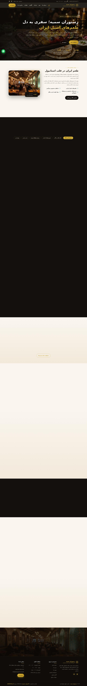

# 🌟 وب‌سایت رستوران سمیه | Somayyeh Restaurant Website

یک وب‌سایت تک‌صفحه‌ای (One-Page) مدرن، راست‌به‌چپ و کاملاً واکنش‌گرا برای **رستوران ایرانی سمیه** — ساخته‌شده با HTML/CSS/JavaScript خالص و **بدون هیچ کتابخانه‌ی بیرونی** (بدون jQuery، بدون Bootstrap، بدون CDN).

> 🎨 **طراحی و کدنویسی ۱۰۰٪ با هوش مصنوعی** — پروژه‌ی `website-by_ai`

---

## 🖼 پیش‌نمایش



<details>
<summary>📱 نمای موبایل (کلیک کنید)</summary>


</details>

---

## ✨ امکانات

| بخش | توضیحات |
|---|---|
| 🏠 **هیرو (Hero)** | تصویر تمام‌صفحه با افکت Ken-Burns، شمارنده‌های عددی فارسی (۶۵+ آیتم منو، ۱۲۰+ ظرفیت) |
| 📖 **درباره ما** | معرفی رستوران + قاب تصویر با حاشیه‌ی طلایی و نشان «۱۲+ سال تجربه» |
| 🍽 **منوی تعاملی** | ۶ دستهٔ منو (پیش‌غذا، کباب، خورش، پلو، دسر، نوشیدنی) با **تب‌های قابل کلیک** و عوض‌شدن خودکار تصویر هر دسته |
| 🥘 **سینی‌های مخصوص** | کارت‌های خانوادگی با افکت زوم روی هاور |
| 🛎 **خدمات** | ۴ کارت خدمات (سالن و تراس، بیرون‌بر، مراسم، منوی گیاهی) |
| 🖼 **گالری تصاویر** | چیدمان Grid نامتقارن + **لایت‌باکس** (باز شدن تصویر با کلیک، بستن با Esc) |
| 💬 **نظرات مهمانان** | اسلایدری/کارتی با ستاره‌های امتیاز |
| 📅 **فرم رزرو میز** | اعتبارسنجی کامل سمت کاربر (نام، تلفن، تاریخ، ساعت، تعداد نفرات) + پیام موفقیت |
| 📍 **اطلاعات تماس** | آدرس، تلفن، واتساپ، ایمیل و ساعات کاری |
| ❓ **سوالات متداول** | آکاردئون با `<details>` بومی و انیمیشن |
| 🟢 **شناورها** | دکمهٔ واتساپ، دکمهٔ بازگشت به بالا، هدر چسبان با منوی موبایل همبرگری |

### ویژگی‌های فنی
- ✅ راست‌به‌چپ کامل (`dir="rtl"`) با فونت Vazirmatn (با fallback به Tahoma برای ویندوز/اندروید)
- ✅ **بدون هیچ منبع خارجی** — فایل‌ها کاملاً آفلاین کار می‌کنند (فونت سیستمی، آیکون‌های SVG درون‌خطی، تصاویر محلی)
- ✅ **واکنش‌گرا**: دسکتاپ، تبلت و موبایل (شکست‌های ۱۰۸۰ / ۹۰۰ / ۶۴۰ پیکسل)
- ✅ **SEO**: تگ‌های Open Graph، توییتر کارت، داده‌های ساخت‌یافتهٔ `schema.org/Restaurant`
- ✅ **دسترس‌پذیری**: برچسب `aria`، ناوبری با کیبورد، احترام به `prefers-reduced-motion`
- ✅ انیمیشن‌های ظاهرشدن هنگام اسکرول با `IntersectionObserver`

---

## 📂 ساختار پروژه

```
somayyeh-restaurant/
├── index.html            ← سایت نهایی (برای GitHub Pages / هاست)
├── preview.html          ← نسخهٔ تک‌فایلِ خودبسنده (همهٔ تصاویر به‌صورت base64 درون فایل)
├── build.py              ← اسکریپت ساخت (سایت عادی + نسخهٔ تک‌فایل)
├── src/
│   └── page.html         ← سورس قالب (منبع ویرایش)
├── assets/
│   └── img/              ← تصاویر (تولیدشده با هوش مصنوعی)
├── docs/                 ← تصاویر پیش‌نمایش برای README
└── README.md
```

> ✏️ **برای ویرایش سایت، فایل `src/page.html` را تغییر دهید و سپس `python3 build.py` را اجرا کنید.**
> (فایل‌های `index.html` و `preview.html` به‌صورت خودکار ساخته می‌شوند.)

---

## 🚀 اجرا و انتشار

### اجرای محلی
```bash
# ساده‌ترین راه: باز کردن فایل
open index.html            # macOS
start index.html           # Windows

# یا با یک سرور محلی (توصیه‌شده)
python3 -m http.server 8000
# سپس در مرورگر: http://localhost:8000
```

### انتشار روی GitHub Pages
1. مخزن را روی GitHub بسازید و پوش کنید (یا همین مخزن را Fork کنید).
2. به **Settings → Pages** بروید.
3. در بخش *Build and deployment*: **Source = Deploy from a branch**، **Branch = `main` / `(root)`**.
4. ذخیره کنید؛ سایت چند لحظه بعد در این نشانی بالا می‌آید:
   `https://<username>.github.io/<repo>/`

---

## ⚙️ شخصی‌سازی سریع

| چه چیزی | کجا |
|---|---|
| شماره تلفن / واتساپ | در `src/page.html` جست‌وجو کنید: `905013252452` |
| آدرس، ایمیل، ساعات کاری | بخش `#contact` و `footer` |
| رنگ طلایی اصلی | در CSS: `--gold: #d4af37` (و `--gold-2`) |
| آیتم‌های منو و قیمت‌ها | بخش `#dishes` (هر آیتم یک `<article class="dish" data-cat="...">`) |
| تصاویر | فایل‌های `assets/img/*.jpg` را با تصاویر خودتان جایگزین کنید (همان نام‌ها) |

---

## 🖼 دربارهٔ تصاویر

همهٔ تصاویر این پروژه **با هوش مصنوعی تولید شده‌اند** و برای جایگزینی با عکس‌های واقعی رستوران در نظر گرفته شده‌اند.
این پروژه یک بازطراحی **اورجینال** است؛ هیچ فایل، کد، متن یا تصویری از سایت‌های دیگر کپی نشده است.

---

## 🔐 نکتهٔ امنیتی مهم

هرگز توکن‌های دسترسی GitHub (`ghp_...`)، کلیدهای Cloudflare (`cfat_...`) یا Hugging Face (`hf_...`) را
در کد، مخزن عمومی، README یا اسکرین‌شات قرار ندهید. اگر توکنی منتشر شد، بلافاصله آن را در
[GitHub → Settings → Developer settings → Tokens](https://github.com/settings/tokens) **Revoke** کنید.
این پروژه هیچ توکنی را در خود نگه نمی‌دارد و برای اجرا به هیچ کلیدی نیاز ندارد.

---

## 📄 مجوز

کد این پروژه تحت مجوز **MIT** منتشر شده است — آزادانه استفاده، تغییر و انتشار دهید.
